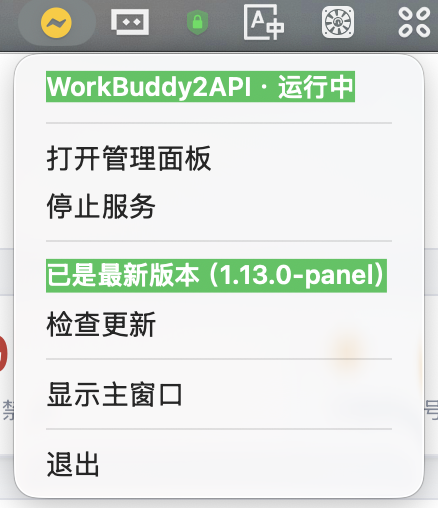
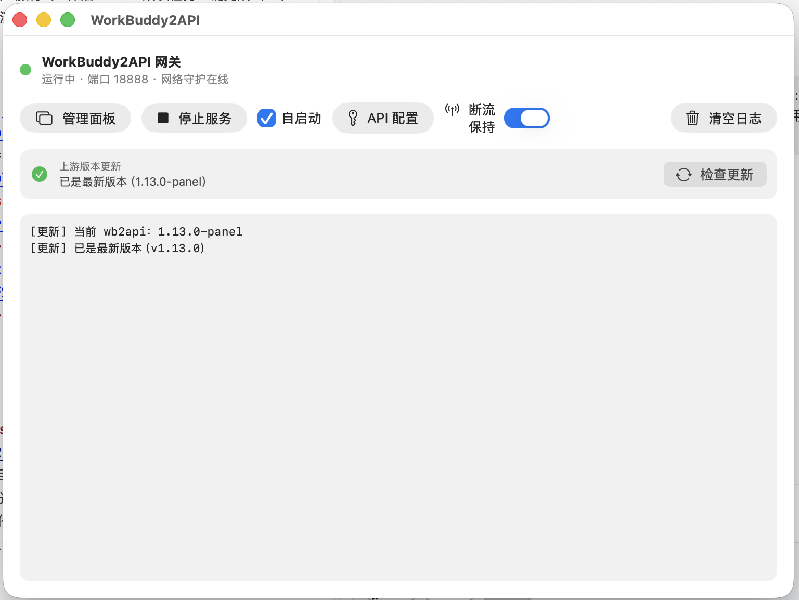
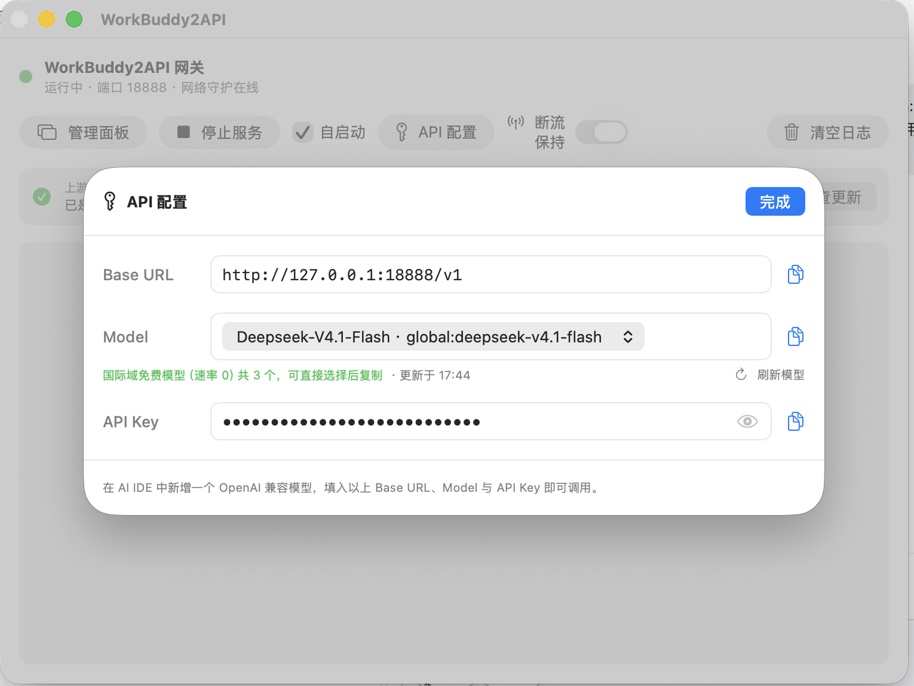

# WorkBuddy2API for macOS

WorkBuddy2API 网关的 **macOS 菜单栏启动器**：常驻系统栏，一键启停 `wb2api`、查看账号池健康度、配置 API、自动跟随上游更新。启动器本身不含网关逻辑，它负责把同目录的 `wb2api` 二进制跑起来。

## 系统要求

- macOS **15.0（Sequoia）或更高**（用到了 SwiftUI 的窗口启动行为 API）
- Apple 芯片（arm64）或 Intel（x86_64），发布包为通用二进制
- 已下载网关本体 `wb2api`（见下节）

## 界面

菜单栏下拉（点图标打开）：



主窗口：



API 配置弹窗（Base URL / 模型 / API Key 一键复制）：



## 安装

### 1. 安装启动器

从 [Releases](https://github.com/hardwin2023/workbuddy2api-panel/releases) 下载 **`WorkBuddy2API-<版本>-full.zip`**（推荐：App 安装包 + 双架构 `wb2api` + 使用说明，一次下完），解压后得到：

```
WorkBuddy2API-<版本>/
├── WorkBuddy2API-<版本>-universal.dmg    ← 双击安装
├── gateway/
│   ├── apple-silicon/wb2api              ← M1~M4 芯片
│   └── intel/wb2api                      ← Intel 芯片
└── 使用说明.txt
```

只想单独要 App 的话，下载 `WorkBuddy2API-<版本>-universal.dmg` 即可。

1. 双击 DMG，把 `WorkBuddy2API.app` 拖进「应用程序」；
2. 首次打开：双击 App，弹出「Apple 无法验证」时点「完成」→ 打开**系统设置 → 隐私与安全性** → 在「安全性」区域点「**仍要打开**」→ 输入开机密码。之后双击即可。

> **为什么需要这一步**：发布包使用 **ad-hoc 签名**，没有购买 Apple 开发者账号（99 美元/年）做公证。
> 注意 macOS 15（Sequoia）起 Apple 已移除「右键 → 打开」的绕过方式，必须在系统设置里放行一次。

如果不想点系统设置，也可以在终端执行一次（等效于放行）：

```bash
xattr -dr com.apple.quarantine /Applications/WorkBuddy2API.app
```

> 每次升级到新版本后可能需要再放行一次（因为签名变了）。

### 2. 准备网关目录

启动器默认在 `~/workbuddy2api` 找 `wb2api`。准备方式三选一：

**方式 A：用 full.zip 里的网关（推荐）**

`full.zip` 已按芯片分好目录，直接把 `gateway/apple-silicon`（M1~M4）或 `gateway/intel` 整个文件夹作为网关目录即可，里面已经有 `wb2api`。

**方式 B：下载官方二进制**

1. 打开 [上游 Releases](https://github.com/linguo2625469/workbuddy2api-panel/releases/latest)，下载 `wb2api-panel-<版本>-darwin-arm64.tar.gz`（Intel 机器选 `darwin-amd64`）；
2. 解压后把 `wb2api` 放到 `~/workbuddy2api/`；
3. 同目录放一份 `config.json`（可复制仓库里的 `config.example.json` 改名）。

```bash
mkdir -p ~/workbuddy2api
tar -xzf ~/Downloads/wb2api-panel-*-darwin-arm64.tar.gz -C ~/workbuddy2api wb2api
cp config.example.json ~/workbuddy2api/config.json   # 在仓库目录下执行
```

**方式 C：已经有网关目录**

首次启动时点提示条上的「**选择网关目录…**」，指向包含 `wb2api` 与 `config.json` 的目录即可；之后也可点工具栏的文件夹图标随时更改。

> 目录选择会记在 `UserDefaults`（键 `workbuddy2api.home`）。也可以用环境变量 `WB2API_HOME` 覆盖：
> `WB2API_HOME=/path/to/dir open -a WorkBuddy2API`

### 3. 添加账号

服务启动后，菜单栏点「管理面板」打开 `http://127.0.0.1:7863/panel/`，用面板「添加账号」完成 OAuth 登录。

## 功能

| 功能 | 说明 |
|---|---|
| **启动 / 停止服务** | 拉起 `wb2api` 子进程，退出 App 时自动停止；端口被占用会提示占用进程 |
| **自启动** | 勾选后 App 启动即拉起服务（默认开启） |
| **状态指示** | 菜单栏图标蓝/黄交替表示运行中；**整只变红闪烁**表示运行中但账号池无可用账号（冷却中 / 已禁用） |
| **账号池探测** | 每 10s 请求 `/healthz`，无可用账号时主窗口状态点与菜单状态行同步变红 |
| **API 配置** | 展示 Base URL / 模型 / API Key，支持掩码切换、一键复制，落盘 `data/models.json` |
| **免费模型** | 从 `/v1/models` 动态筛选积分倍率为 `x0.00` 的模型，随时刷新 |
| **断流保持** | 监听网络切换（Wi-Fi / 有线 / 休眠唤醒），恢复后自动重启服务，重建连接池 |
| **运行日志** | 保留最近 3000 行，每 30 分钟自动清空一次，也可手动清空 |
| **检查更新** | 读取本地二进制版本，对比上游 Releases，一键下载 + sha256 校验 + 备份 + 原子替换 + 重启；只替换 `wb2api`，不碰 `config.json` / `auths/` / `data/` |

## 从源码构建

需要 Xcode 命令行工具（`xcode-select --install`）。

```bash
bash macapp/build.sh              # 通用二进制（arm64 + x86_64），产出 macapp/WorkBuddy2API.app
bash macapp/build.sh --native     # 仅本机架构，编译更快
bash macapp/build.sh --dmg        # 额外产出 macapp/dist/WorkBuddy2API-<版本>-universal.dmg
APP_VERSION=1.1.0 bash macapp/build.sh --dmg
```

版本号通过 `Info.plist` 的 `CFBundleShortVersionString` 注入；产物为 ad-hoc 签名（`codesign --sign -`）。

## 目录结构

```
macapp/
├── Sources/
│   ├── WorkBuddyApp.swift      # @main、MenuBarExtra、菜单栏图标着色与闪烁
│   ├── AppDelegate.swift       # 激活策略、退出时停服
│   ├── ProcessManager.swift    # 子进程管理、端口探测、账号池轮询、网络守护
│   ├── AppConfig.swift         # 网关目录发现、端口与 api_key 读取
│   ├── ContentView.swift       # 主窗口
│   ├── MenuContent.swift       # 系统栏菜单
│   ├── APIConfigView.swift     # API 配置弹窗
│   ├── ModelCatalog.swift      # /v1/models 拉取与免费模型筛选
│   ├── WebPanelView.swift      # 内嵌 WKWebView 管理面板
│   ├── LogStore.swift          # 环形日志缓冲 + 定时清空
│   ├── NetworkKeeper.swift     # NWPathMonitor 网络监听
│   └── UpdateChecker.swift     # 上游版本检查与一键更新
├── Info.plist
├── Resources/AppIcon.icns
└── build.sh
```

## 常见问题

**提示「未找到网关二进制（wb2api）」**
点「选择网关目录…」指向正确的目录，或按上文把 `wb2api` 放到 `~/workbuddy2api/`。

**菜单栏图标变红闪烁**
服务在跑，但账号池里没有可用账号（全部冷却 / 被禁用 / 积分耗尽）。打开管理面板查看账号状态。

**端口 7863 被占用**
通常是上一个 `wb2api` 进程没退干净。启动器会在日志里打印占用 PID，可执行 `kill <pid>` 后重试。

**更新失败提示「未提供 sha256 校验值」**
该发布未附校验值，为安全起见已中止。到 Releases 页手动下载替换即可。

## License

MIT，见仓库根目录 [LICENSE](../LICENSE) 与 [NOTICE](../NOTICE)。
